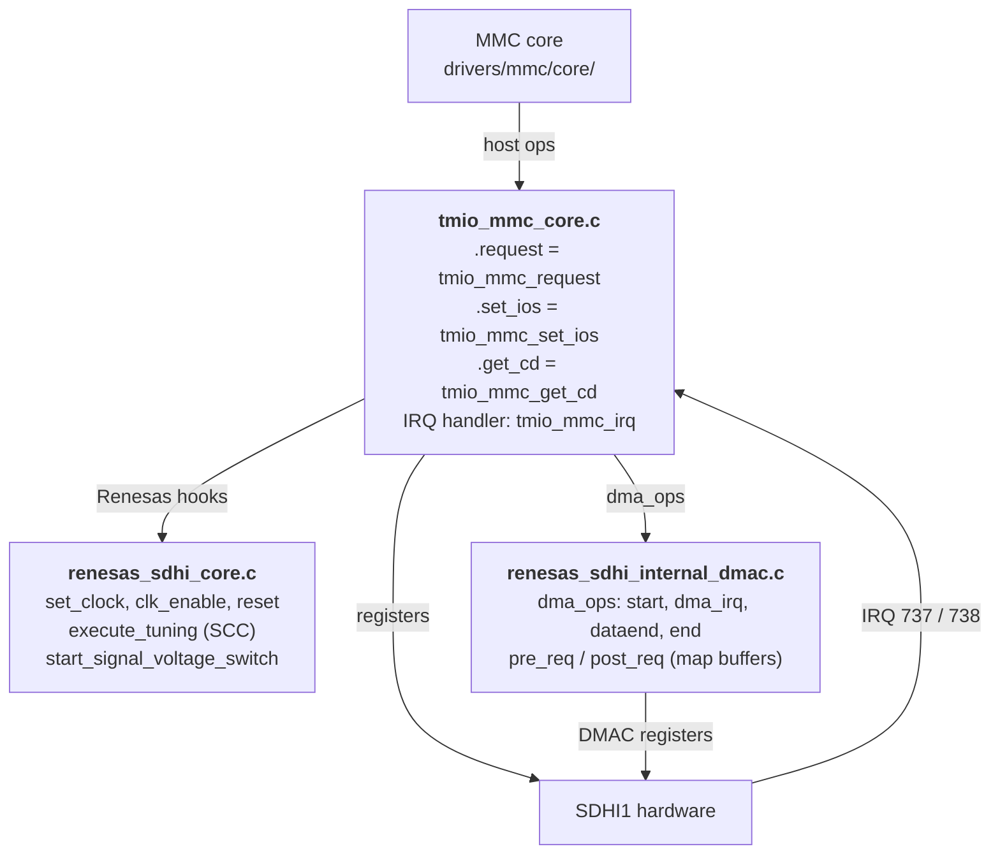
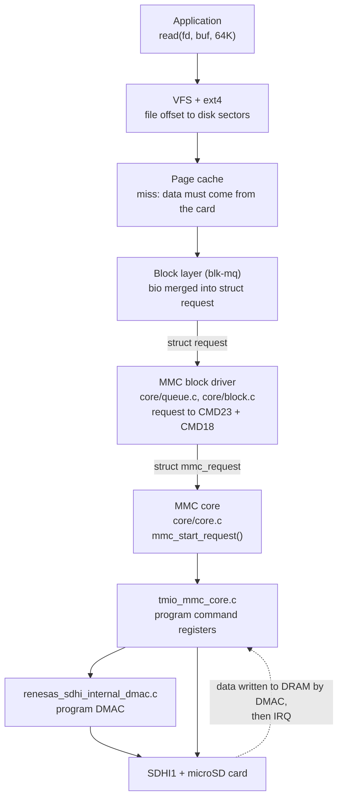
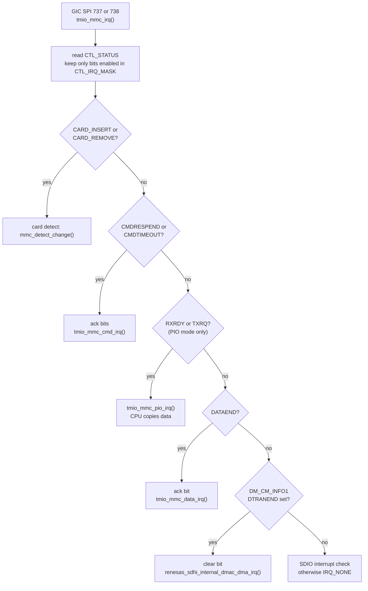
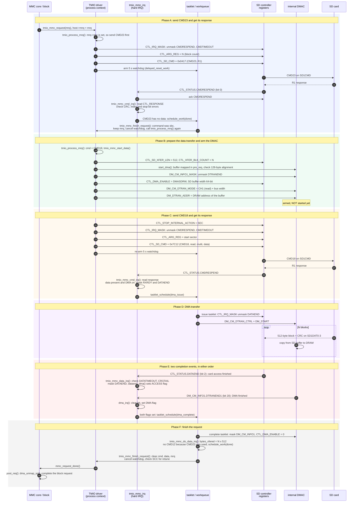
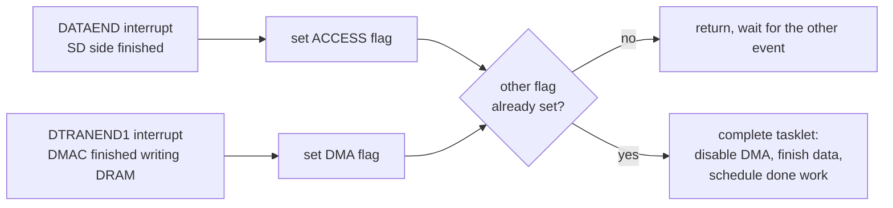

# RZ/V2H SDHI Driver and SD Card Read Process (rz-6.1-cip48)

All file paths are relative to the kernel source root; linked files are copies in `related_source/`, and line numbers are from commit `1cac8c7e4`.

> **Viewing the diagrams:** they are written in Mermaid. In VS Code, install the extension **"Markdown Preview Mermaid Support"** (`bierner.markdown-mermaid`). GitHub and GitLab render them natively.

---

## 1. SDHI on RZ/V2H

The RZ/V2H has three SDHI (SD Host Interface) controllers. The EVK uses **SDHI1** for the microSD slot, which appears in Linux as **`/dev/mmcblk1`**.

| Controller | Base address | IRQs (GIC SPI) | Used on EVK |
|---|---|---|---|
| `sdhi0` | `0x15c00000` | 735, 736 | no |
| `sdhi1` | `0x15c10000` | 737, 738 | **yes**, microSD, 4-bit, up to SDR104 |
| `sdhi2` | `0x15c20000` | 739, 740 | no |

Each controller contains:

- **SD bus interface:** the CLK, CMD and DAT0-3 lines to the card.
- **Internal DMAC:** moves data directly between the card and DRAM.
- **SCC (Sampling Clock Controller)** at base + `0x1000`: adjusts the sampling point at high speed (SDR50/SDR104).

Clocks from the CPG:

| `clock-names` | Purpose |
|---|---|
| `core` | main clock; SD1CLK is divided from it |
| `clkh` | high-speed clock for SDR104 |
| `cd` | card-detect logic |
| `aclk` | AXI bus clock used by the internal DMAC |

Device tree:

- SoC nodes: [r9a09g057.dtsi:2218](related_source/arch/arm64/boot/dts/renesas/r9a09g057.dtsi#L2218)
- EVK enables SDHI1: [r9a09g057h44-rzv2h-evk.dts:1185](related_source/arch/arm64/boot/dts/renesas/r9a09g057h44-rzv2h-evk.dts#L1185)

```dts
&sdhi1 {
	pinctrl-0 = <&sdhi1_pins>;
	pinctrl-1 = <&sdhi1_pins>;
	pinctrl-names = "default", "state_uhs";
	vmmc-supply = <&reg_3p3v>;        /* card power: fixed 3.3 V          */
	vqmmc-supply = <&vqmmc_sdhi1>;    /* IO voltage 3.3 / 1.8 V (GPIO PA2) */
	bus-width = <4>;
	sd-uhs-sdr50;
	sd-uhs-sdr104;
	status = "okay";
};
```

---

## 2. SDHI driver structure

The driver is built in (`CONFIG_MMC_SDHI=y`, `CONFIG_MMC_SDHI_INTERNAL_DMAC=y`) and made of three files in `drivers/mmc/host/`:

| File | Role |
|---|---|
| [renesas_sdhi_internal_dmac.c](related_source/drivers/mmc/host/renesas_sdhi_internal_dmac.c) | Entry point: matches `"renesas,sdhi-r9a09g057"`, implements the internal DMAC operations |
| [renesas_sdhi_core.c](related_source/drivers/mmc/host/renesas_sdhi_core.c) | Renesas-specific parts: probe, clocks, reset, SCC tuning, voltage switch |
| [tmio_mmc_core.c](related_source/drivers/mmc/host/tmio_mmc_core.c) | Generic TMIO engine: implements `mmc_host_ops`, sends commands, handles IRQs |

The MMC core only ever calls `tmio_mmc_core.c`. TMIO then calls Renesas code through function pointers:



### RZ/V2H settings that affect reads

RZ/V2H reuses the RZ/G2L configuration (`of_rzg2l_compatible`, [renesas_sdhi_internal_dmac.c:260](related_source/drivers/mmc/host/renesas_sdhi_internal_dmac.c#L260)):

| Setting | Effect on a read |
|---|---|
| `max_segs = 1` | The DMAC takes **one contiguous buffer** per request, so the MMC core never sends a scattered list. |
| 128-byte alignment | Buffers must be 128-byte aligned for DMA. Otherwise the driver falls back to PIO, where the CPU copies the data ([line 396](related_source/drivers/mmc/host/renesas_sdhi_internal_dmac.c#L396)). |
| `fixed_addr_mode` quirk | The address-mode bit in `DM_DTRAN_MODE` is not set. |
| `MMC_CAP_CMD23` | Multi-block reads use CMD23 (SET_BLOCK_COUNT) before CMD18, so no CMD12 STOP is needed. |

---

## 3. Read process

### 3.1 Layers involved



### 3.2 Step by step

This is the overview. Section 4 shows the command, response, DMA and interrupt handling at register level.

**Phase 1: from `read()` to an MMC request**

| # | Function | File | What happens |
|---|---|---|---|
| 1 | `read()` → `vfs_read()` | VFS | The application asks for file data. |
| 2 | ext4 + page cache | fs/ | On a cache miss, ext4 maps the file offset to sectors and submits a `bio`. |
| 3 | blk-mq | block/ | The `bio` is merged into a `struct request` and sent to the `/dev/mmcblk1` queue. |
| 4 | `mmc_mq_queue_rq()` | [core/queue.c:227](related_source/drivers/mmc/core/queue.c#L227) | The MMC block driver receives the request. |
| 5 | `mmc_blk_mq_issue_rq()` | [core/block.c:2405](related_source/drivers/mmc/core/block.c#L2405) | Identifies it as a read/write and calls `mmc_blk_mq_issue_rw_rq()` ([line 2358](related_source/drivers/mmc/core/block.c#L2358)). |
| 6 | `mmc_blk_rw_rq_prep()` | [core/block.c:1675](related_source/drivers/mmc/core/block.c#L1675) | Builds an `mmc_request`: **CMD23** (block count) + **CMD18** (READ_MULTIPLE_BLOCK) with start sector, plus the data buffer list. |
| 7 | `pre_req()` | renesas_sdhi_internal_dmac.c | Maps the buffer for DMA (`dma_map_sg`) ahead of time. |
| 8 | `mmc_start_request()` | [core/core.c:335](related_source/drivers/mmc/core/core.c#L335) | Calls the host driver: `host->ops->request()`. |

**Phase 2: SDHI driver programs the hardware**

| # | Function | File | What happens |
|---|---|---|---|
| 9 | `tmio_mmc_request()` | [tmio_mmc_core.c:830](related_source/drivers/mmc/host/tmio_mmc_core.c#L830) | Stores the request and calls `tmio_process_mrq()` ([line 798](related_source/drivers/mmc/host/tmio_mmc_core.c#L798)). CMD23 is sent first, then CMD18. |
| 10 | `tmio_mmc_start_data()` | [tmio_mmc_core.c:762](related_source/drivers/mmc/host/tmio_mmc_core.c#L762) | Writes block size and block count to the SDHI. |
| 11 | `renesas_sdhi_internal_dmac_start_dma()` | [renesas_sdhi_internal_dmac.c:406](related_source/drivers/mmc/host/renesas_sdhi_internal_dmac.c#L406) | Checks 128-byte alignment, writes the DRAM address to `DM_DTRAN_ADDR` and selects channel 1 (read) in `DM_CM_DTRAN_MODE`. The DMAC is **armed but not started** yet. If the buffer is unaligned, it falls back to PIO. |
| 12 | `tmio_mmc_start_command()` | [tmio_mmc_core.c:290](related_source/drivers/mmc/host/tmio_mmc_core.c#L290) | Writes the argument (sector) to `CTL_ARG_REG` and the command to `CTL_SD_CMD`. The SDHI starts sending CMD18. |

**Phase 3: hardware transfer**

| # | Who | What happens |
|---|---|---|
| 13 | SDHI1 | Sends CMD18 on SD1CMD and receives the card's response. A response-end interrupt fires. |
| 14 | `tmio_mmc_cmd_irq()` → DMA issue tasklet | After the response, the tasklet writes `DM_START` to `DM_CM_DTRAN_CTRL`, which starts the DMAC ([renesas_sdhi_internal_dmac.c:446](related_source/drivers/mmc/host/renesas_sdhi_internal_dmac.c#L446)). |
| 15 | Card + DMAC | The card streams data on SD1DAT0-3, and the internal DMAC copies it from the SD buffer into DRAM. The CPU is not involved. |

**Phase 4: interrupt and completion**

| # | Function | File | What happens |
|---|---|---|---|
| 16 | `tmio_mmc_irq()` | [tmio_mmc_core.c:739](related_source/drivers/mmc/host/tmio_mmc_core.c#L739) | IRQ 737/738 fires. Reads `CTL_STATUS` and dispatches. |
| 17 | `renesas_sdhi_internal_dmac_dma_irq()` | [renesas_sdhi_internal_dmac.c:329](related_source/drivers/mmc/host/renesas_sdhi_internal_dmac.c#L329) | DMA transfer end: sets the "DMA done" flag. |
| 18 | `tmio_mmc_data_irq()` → `dataend` | [tmio_mmc_core.c:548](related_source/drivers/mmc/host/tmio_mmc_core.c#L548) | SD access end: sets the "access done" flag. |
| 19 | complete tasklet | [renesas_sdhi_internal_dmac.c:490](related_source/drivers/mmc/host/renesas_sdhi_internal_dmac.c#L490) | Runs only after **both** flags are set. Unmaps the buffer and calls `tmio_mmc_do_data_irq()`. |
| 20 | `tmio_mmc_finish_request()` | [tmio_mmc_core.c:856](related_source/drivers/mmc/host/tmio_mmc_core.c#L856) | Completes the request and calls `mmc_request_done()` ([core.c:139](related_source/drivers/mmc/core/core.c#L139)). |

**Phase 5: back to the application**

| # | Function | What happens |
|---|---|---|
| 21 | `mmc_blk_mq_req_done()` ([block.c:2264](related_source/drivers/mmc/core/block.c#L2264)) | Checks for errors and calls `post_req()`. |
| 22 | `blk_mq_complete_request()` | Ends the block request and calls the `bio` completion. |
| 23 | page cache → ext4 → VFS | Pages are marked up to date and the data is copied to `buf`. `read()` returns. |

### 3.3 Call chain (quick reference)

```
read()
 → vfs_read → ext4 → submit_bio → blk-mq
 → mmc_mq_queue_rq                                   core/queue.c:227
 → mmc_blk_mq_issue_rq → mmc_blk_mq_issue_rw_rq      core/block.c:2405, 2358
 → mmc_start_request                                 core/core.c:335
 → tmio_mmc_request → tmio_process_mrq               host/tmio_mmc_core.c:830, 798
 → renesas_sdhi_internal_dmac_start_dma              host/renesas_sdhi_internal_dmac.c:406
 → tmio_mmc_start_command                            host/tmio_mmc_core.c:290
 → tmio_mmc_irq → tmio_mmc_cmd_irq                   host/tmio_mmc_core.c:739, 598
 → renesas_sdhi_internal_dmac_issue_tasklet_fn       host/renesas_sdhi_internal_dmac.c:446  (DMAC start)
 ══ hardware transfer (DMAC → DRAM) ══
 → tmio_mmc_irq → tmio_mmc_data_irq / dma_irq        host/tmio_mmc_core.c:548, internal_dmac.c:329
 → renesas_sdhi_internal_dmac_complete_tasklet_fn    host/renesas_sdhi_internal_dmac.c:490
 → tmio_mmc_finish_request → mmc_request_done        host/tmio_mmc_core.c:856, core/core.c:139
 → mmc_blk_mq_req_done → blk_mq_complete_request     core/block.c:2264
 → bio end_io → read() returns
```

---

## 4. Detailed flow: command, response, DMA and interrupts

A read of N blocks reaches the SDHI driver as **one `mmc_request` containing two commands**:

| Part | Command | Argument | Data |
|---|---|---|---|
| `mrq->sbc` | CMD23 SET_BLOCK_COUNT | N | none |
| `mrq->cmd` | CMD18 READ_MULTIPLE_BLOCK | start sector | N × 512 bytes |

The TMIO driver runs them one after the other. Each command goes **send → response interrupt → (data transfer) → completion**. Because CMD23 told the card how many blocks to send, no CMD12 STOP is needed at the end.

### 4.1 Registers used

The TMIO registers are 16-bit registers placed 4 bytes apart (`bus_shift = 2`), so the byte offset from the SDHI base is the code offset shifted left by 2. The DMAC registers are used at their raw offset. Compare these against the RZ/V2H hardware manual's register names.

**SD controller (TMIO)**, [tmio_mmc.h:26-47](related_source/drivers/mmc/host/tmio_mmc.h#L26-L47)

| Register (code name) | Code offset | Byte offset | Used for |
|---|---|---|---|
| `CTL_SD_CMD` | 0x00 | 0x000 | Command index + flags. **Writing it sends the command.** |
| `CTL_ARG_REG` | 0x04 | 0x010 | Command argument (CMD23: block count, CMD18: start sector) |
| `CTL_STOP_INTERNAL_ACTION` | 0x08 | 0x020 | `SEC` bit: use the block count for multi-block transfers |
| `CTL_XFER_BLK_COUNT` | 0x0a | 0x028 | Number of blocks |
| `CTL_RESPONSE` | 0x0c | 0x030 | Card response (up to 4 × 32 bits) |
| `CTL_STATUS` | 0x1c | 0x070 | Status and interrupt flags. Write 0 to a bit to clear (ack) it. |
| `CTL_IRQ_MASK` | 0x20 | 0x080 | Interrupt mask (1 = masked) |
| `CTL_SD_XFER_LEN` | 0x26 | 0x098 | Block size (512) |
| `CTL_DMA_ENABLE` | 0xd8 | 0x360 | `DMASDRW` bit: connect the SD data buffer to the DMAC |

**Internal DMAC**, [renesas_sdhi_internal_dmac.c:26-58](related_source/drivers/mmc/host/renesas_sdhi_internal_dmac.c#L26-L58)

| Register | Offset | Used for |
|---|---|---|
| `DM_CM_DTRAN_MODE` | 0x820 | Channel: CH1 (bit 16) = read / upstream, CH0 = write / downstream; bus width bits |
| `DM_CM_DTRAN_CTRL` | 0x828 | `DM_START` (bit 0): **starts the DMA transfer** |
| `DM_CM_RST` | 0x830 | Resets DMA channels after an error |
| `DM_CM_INFO1` | 0x840 | `DTRANEND1` (bit 20) = read channel done, `DTRANEND0` (bit 16) = write channel done |
| `DM_CM_INFO1_MASK` | 0x848 | Mask for `DM_CM_INFO1` |
| `DM_CM_INFO2` | 0x850 | DMA error flags (`DTRANERR0/1`) |
| `DM_DTRAN_ADDR` | 0x880 | DRAM address of the buffer |

**`CTL_SD_CMD` values for a read** ([tmio_mmc_core.c:290](related_source/drivers/mmc/host/tmio_mmc_core.c#L290)):

| Command | Bits | Value |
|---|---|---|
| CMD23 | index 23 (0x17) + `RESP_R1` (0x0400) | **0x0417** |
| CMD18 | index 18 (0x12) + `RESP_R1` + `DATA_PRESENT` (0x0800) + `TRANSFER_READ` (0x1000) + `TRANSFER_MULTI` (0x2000) + `NO_CMD12_ISSUE` (0x4000) | **0x7C12** |

### 4.2 Interrupt sources

Both SDHI1 interrupt lines (GIC SPI 737 and 738) go to the same handler, `tmio_mmc_irq()`. It checks two sets of status bits.

| Source register | Bit | Name | Meaning |
|---|---|---|---|
| `CTL_STATUS` | 0 | `CMDRESPEND` | Response received from the card |
| `CTL_STATUS` | 22 | `CMDTIMEOUT` | Card did not answer the command |
| `CTL_STATUS` | 2 | `DATAEND` | SD-side data access finished (all blocks received) |
| `CTL_STATUS` | 24 | `RXRDY` | Data in buffer: used only in PIO mode, masked when DMA is used |
| `CTL_STATUS` | 3, 4 | `CARD_REMOVE`, `CARD_INSERT` | Card detect |
| `CTL_STATUS` | 16, 17, 18, 19 | `CMD_IDX_ERR`, `CRCFAIL`, `STOPBIT_ERR`, `DATATIMEOUT` | Error flags. They don't raise interrupts on their own. The driver reads them when `CMDRESPEND` or `DATAEND` fires. |
| `DM_CM_INFO1` | 20 | `DTRANEND1` | DMAC finished writing the read data to DRAM |

### 4.3 How the interrupt handler dispatches

[tmio_mmc_irq()](related_source/drivers/mmc/host/tmio_mmc_core.c#L739) → [__tmio_mmc_sdcard_irq()](related_source/drivers/mmc/host/tmio_mmc_core.c#L683). Only one event is handled per call. If more are pending, the interrupt line stays active and the handler runs again.



### 4.4 Full sequence of one read



**Code for each phase:**

| Phase | Functions |
|---|---|
| A | [tmio_mmc_request](related_source/drivers/mmc/host/tmio_mmc_core.c#L830), [tmio_process_mrq](related_source/drivers/mmc/host/tmio_mmc_core.c#L798), [tmio_mmc_start_command](related_source/drivers/mmc/host/tmio_mmc_core.c#L290), [tmio_mmc_cmd_irq](related_source/drivers/mmc/host/tmio_mmc_core.c#L598), [tmio_mmc_done_work](related_source/drivers/mmc/host/tmio_mmc_core.c#L903), [tmio_mmc_finish_request](related_source/drivers/mmc/host/tmio_mmc_core.c#L856) |
| B | [tmio_mmc_start_data](related_source/drivers/mmc/host/tmio_mmc_core.c#L762), [renesas_sdhi_internal_dmac_start_dma](related_source/drivers/mmc/host/renesas_sdhi_internal_dmac.c#L406), [renesas_sdhi_internal_dmac_enable_dma](related_source/drivers/mmc/host/renesas_sdhi_internal_dmac.c#L298), [renesas_sdhi_enable_dma](related_source/drivers/mmc/host/renesas_sdhi_core.c#L921) |
| C | [tmio_mmc_start_command](related_source/drivers/mmc/host/tmio_mmc_core.c#L290), [tmio_mmc_cmd_irq](related_source/drivers/mmc/host/tmio_mmc_core.c#L598) |
| D | [renesas_sdhi_internal_dmac_issue_tasklet_fn](related_source/drivers/mmc/host/renesas_sdhi_internal_dmac.c#L446) |
| E | [tmio_mmc_data_irq](related_source/drivers/mmc/host/tmio_mmc_core.c#L548), [renesas_sdhi_internal_dmac_dataend_dma](related_source/drivers/mmc/host/renesas_sdhi_internal_dmac.c#L350), [renesas_sdhi_internal_dmac_dma_irq](related_source/drivers/mmc/host/renesas_sdhi_internal_dmac.c#L329) |
| F | [renesas_sdhi_internal_dmac_complete_tasklet_fn](related_source/drivers/mmc/host/renesas_sdhi_internal_dmac.c#L490), [renesas_sdhi_internal_dmac_complete](related_source/drivers/mmc/host/renesas_sdhi_internal_dmac.c#L464), [tmio_mmc_do_data_irq](related_source/drivers/mmc/host/tmio_mmc_core.c#L493), [tmio_mmc_finish_request](related_source/drivers/mmc/host/tmio_mmc_core.c#L856) |

### 4.5 Why the driver waits for two events

`DATAEND` and `DTRANEND1` report two different things:

- **`DATAEND`** (SD controller): all blocks have arrived from the card into the SD buffer.
- **`DTRANEND1`** (DMAC): the DMAC has finished writing that data into DRAM.

They can arrive in either order. If the driver finished on `DATAEND` alone, the last bytes might not be in DRAM yet, and the application would read stale data. So each event sets a flag, and only the second one starts the completion tasklet.



### 4.6 Interrupt masks over time

| Moment | `CTL_IRQ_MASK` (SD controller) | `DM_CM_INFO1_MASK` (DMAC) |
|---|---|---|
| CMD23 sent | `CMDRESPEND`, `CMDTIMEOUT` unmasked | masked |
| CMD18 prepared (Phase B) | unchanged | `DTRANEND` unmasked |
| CMD18 response handled | `RXRDY`, `DATAEND` masked (no PIO) | unmasked |
| DMA started (issue tasklet) | `DATAEND` unmasked | unmasked |
| `DATAEND` handled | `DATAEND` masked | unmasked |
| Complete tasklet | unchanged | all masked, `CTL_DMA_ENABLE = 0` |

### 4.7 Execution contexts

| Context | Runs | May sleep? |
|---|---|---|
| Process / blk-mq worker | `tmio_mmc_request`, `tmio_process_mrq`, register setup | no (holds spinlock briefly) |
| Hard IRQ | `tmio_mmc_irq`, `tmio_mmc_cmd_irq`, `tmio_mmc_data_irq`, `dma_irq` | no |
| Tasklet (softirq) | `dma_issue` (starts DMAC), `dma_complete` (ends DMA) | no |
| Workqueue | `tmio_mmc_done_work` → `tmio_mmc_finish_request`; the watchdog `tmio_mmc_reset_work` | yes |

### 4.8 Errors and timeouts

| Problem | Detected by | Result |
|---|---|---|
| Card does not answer a command | `CMDTIMEOUT` interrupt → `tmio_mmc_cmd_irq()` | `cmd->error = -ETIMEDOUT`, request ends |
| Response CRC, index or stop-bit error | `CRCFAIL` / `CMD_IDX_ERR` / `STOPBIT_ERR` read at `CMDRESPEND` | `-EILSEQ`. The issue tasklet does not start the DMAC and just sets the DMA flag, so the request still finishes cleanly. |
| Data CRC error or data timeout | `CRCFAIL` / `DATATIMEOUT` read at `DATAEND` | `data->error = -EILSEQ` or `-ETIMEDOUT` |
| No interrupt at all | 5-second watchdog [tmio_mmc_reset_work](related_source/drivers/mmc/host/tmio_mmc_core.c#L229) | dmesg `timeout waiting for hardware interrupt (CMDxx)`, controller reset, `-ETIMEDOUT` |
| Any error at finish | `tmio_mmc_finish_request()` | ack all interrupts, then `abort_dma()` resets DMA channels via `DM_CM_RST` ([line 315](related_source/drivers/mmc/host/renesas_sdhi_internal_dmac.c#L315)) |
| Sampling-point drift at SDR104 | SCC error check (`check_retune`) | `mmc_retune_needed()`: tuning runs again before the next request |

After an error, the MMC block driver (`mmc_blk_mq_rw_recovery()`) decides whether to retry, possibly with fewer blocks or a slower bus.

### 4.9 Difference for a write (CMD25)

| | Read (CMD18) | Write (CMD25) |
|---|---|---|
| DMAC channel | CH1 (upstream), done bit `DTRANEND1` (bit 20) | CH0 (downstream), done bit `DTRANEND0` (bit 16) |
| `CTL_SD_CMD` | `TRANSFER_READ` set | `TRANSFER_READ` not set |
| DMA direction | `DMA_FROM_DEVICE` | `DMA_TO_DEVICE` |
| `DATAEND` handling | finishes at once | also waits until the card is no longer busy programming flash (`SCLKDIVEN`, bit 29). This may take a second `DATAEND`. |
